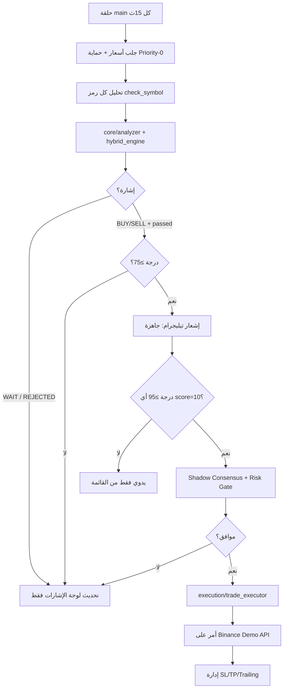

# GoldenShield AI — من الألف إلى الياء

دليل شامل لهيكل المشروع، تدفق التشغيل، وربطه بـ Binance Demo (بعد إلغاء MetaTrader).

---

## 1) ما هو المشروع؟

**GoldenShield AI** بوت تداول آلي/شبه آلي للعملات الرقمية:

1. يجلب الشموع والأسعار من **Binance**
2. يحلّل كل زوج (مؤشرات + محرك هجين)
3. يمرّر القرار عبر بوابات مخاطر (Iron Protocol)
4. يفتح/يدير/يغلق الصفقات على **Binance Demo**
5. يعرض الحالة على **Telegram** (لوحة + بث حي)

الوضع الحالي المقصود: **Binance Demo فقط** — لا MT5، لا فوركس، لا أسهم، لا أموال حقيقية إلا بطلب صريح.

---

## 2) الحجر الأول: نقطة الدخول

| ملف | الدور |
|-----|--------|
| `main.py` | حلقة التشغيل الرئيسية (`run_bot`) |
| `00_START.bat` / `00_STOP.bat` | تشغيل/إيقاف على ويندوز |
| `.env` | الأسرار والإعدادات (لا يُرفع إلى Git) |
| `config/settings.yaml` + `config/settings.py` | الإعدادات الافتراضية الآمنة |
| `config/runtime_profile.py` | ملف التشغيل: دائماً `execution_backend=binance` |

عند الإقلاع:

1. Pre-Flight (اتصال، مفاتيح، مسارات)
2. تحميل الأزواج من `config/trading_pairs.yaml`
3. تهيئة Telegram polling
4. حلقة كل `LOOP_INTERVAL_SECONDS` (افتراضي **15 ثانية**)

---

## 3) طبقات المشروع (من تحت لفوق)

```
config/          ← إعدادات، أزواج، ملف تشغيل
data/            ← اتصال Binance، OHLCV، توجيه الرموز
core/            ← التحليل الفني + المحرك الهجين
audit/           ← Shadow Consensus / سجل القرارات
risk/            ← مخاطر، Iron Protocol، دروع
execution/       ← تنفيذ الأوامر + إدارة المراكز
operations/      ← Telegram، لوحة، أوامر، حالة التشغيل
storage/         ← DB، سجلات، نسخ احتياطي (محلي/VPS)
scripts/         ← نشر، تشخيص، حزم ويندوز
tests/           ← اختبارات الوحدة
docs/            ← وثائق
```

---

## 4) مسار الصفقة من الإشارة إلى التنفيذ



### قواعد الدرجات (مهمة جداً)

| درجة /10 | نسبة | ماذا يحدث؟ |
|----------|------|------------|
| أقل من 8 | أقل من 75 | لا دخول — WAIT/ضعيف |
| 8 | 75 | إشارة يدوية إن كانت BUY/SELL |
| 9 | 90 | يدوي فقط — **ليس تلقائي** |
| 10 | 100 | تلقائي (Soft/Golden) حتى 5 مراكز ناعمة |

Iron Protocol في Live يفرض `auto_entry_min_percent=95` — لذلك **لن يفتح البوت وحده** إلا عند فرصة ذهبية تقريباً (10/10).

---

## 5) طبقة البيانات (Binance)

- `data/` يجلب السوق عبر CCXT/REST حسب الإعداد
- مع `BINANCE_DEMO_TRADING=true` يستخدم `https://demo-api.binance.com`
- الأزواج النشطة من `trading_pairs.yaml` (حالياً ~14 زوج كريبتو `*/USDT`)
- `data/symbol_routing.py` يوحّد أسماء العرض والأسعار

---

## 6) طبقة التحليل

| مكوّن | ملف | وظيفة |
|--------|------|--------|
| التحليل الرئيسي | `core/analyzer.py` | يجمع تقني + هجين → `AnalysisResult` |
| تسجيل النقاط | `core/technical/signal_scorer.py` | درجة من 0–10 |
| هجين | `core/hybrid_engine.py` | يحوّل التقني إلى BUY/SELL/WAIT/REJECTED |
| ثوابت العتبات | `core/constants.py` | 75 يدوي / 95 تلقائي / حد 5 مراكز |

حتى لو الدرجة عالية (مثلاً 9/10) قد تبقى الحالة **WAIT** إذا لم يكتمل شرط الاتجاه/المحاذاة في المحرك الهجين.

---

## 7) طبقة المخاطر والتنفيذ

| مكوّن | دور |
|--------|-----|
| `risk/iron_protocol.py` | يفرض SL/TP، Auto≥95، R:R≥1:3 في Live |
| `risk/risk_orchestrator.py` | موافقة المخاطر قبل الدخول |
| `risk/advanced_shields.py` | انقطاع شبكة، فلاش كراش، … |
| `execution/trade_executor.py` | فتح/إغلاق/إدارة |
| `execution/mt5_bridge.py` | **ملغى** — يرفض الاتصال في وضع Binance |

---

## 8) طبقة Telegram

| ملف | دور |
|-----|-----|
| `operations/telegram_bot.py` | إرسال/تعديل الرسائل |
| `operations/telegram_dashboard.py` | لوحة + **بث حي للمراكز** + **بث حي للإشارات كل 15ث** |
| `operations/telegram_commands.py` | أوامر وcallbacks + خيط long-poll |
| `operations/signal_filter.py` | يصفّي ما يُرسل كـ «صفقة جاهزة» (≥75 BUY/SELL) |
| `operations/dashboard_templates.py` | قوالب النصوص العربية |

### أنواع الرسائل

1. **بث حي — الإشارات**: رسالة واحدة تُحدَّث كل ~15 ثانية بكل الأزواج (بما فيها WAIT)
2. **صفقات جاهزة**: تُرسل فقط عند ظهور BUY/SELL ≥75
3. **مراكزي حي**: تحديث أسعار المراكز كل ~5 ثوانٍ عند فتح القائمة
4. **Health Check**: نبضة ساعية اختيارية

---

## 9) لماذا «5 أيام بلا صفقات ولا إشارات»؟

هذا **ليس** لأن Contabo متوقف أو الربط مكسور بالكامل. التشخيص الحي أظهر:

1. البوت يعمل من `C:\GoldenShield_Binance` ويحلّل كل 15 ثانية
2. رصيد Demo متصل (~5000 USDT)
3. معظم الدورات: كل الأزواج **WAIT** بدرجات 3–6/10؛ أحياناً ATOM 9/10 لكن ما زال WAIT
4. تيليجرام القديم كان يرسل فقط فرص ≥75 BUY/SELL → السوق الهادئ = **صمت ظاهري**
5. الدخول التلقائي يحتاج **95/100 (درجة 10)** → نادر جداً بتصميم الحماية
6. سابقاً: وضع paper / نقص رصيد / إيقاف إشارات الدورة / حزم MT5 قديمة متعارضة

**الخلاصة:** الربط الأساسي يعمل؛ «عدم فتح صفقات» ناتج عن **عتبات صارمة + سوق بلا إعداد دخول**، و«عدم رؤية إشارات» ناتج عن **فلتر الإرسال** وليس توقف التحليل.

---

## 10) ما الذي أُصلح مؤخراً؟

- لوحة **بث حي للإشارات كل 15 ثانية** (كل الأزواج)
- عدم فرض `mt5_attach_sl_tp` عندما الخلفية Binance
- الإبقاء على Demo + `LOOP_INTERVAL_SECONDS=15`
- مسار تشغيل نظيف: `C:\GoldenShield_Binance`

---

## 11) إعدادات `.env` الحرجة (بدون أسرار)

```env
EXECUTION_MODE=live
EXECUTION_BACKEND=binance
BINANCE_DEMO_TRADING=true
MT5_ENABLED=false
LOOP_INTERVAL_SECONDS=15
AUTO_ENTRY_MIN_PERCENT=95
TELEGRAM_SEND_CYCLE_SIGNALS=true
TELEGRAM_LIVE_SIGNALS=true
TELEGRAM_LIVE_SIGNALS_SECONDS=15
TELEGRAM_SIGNALS_ONLY=false
```

---

## 12) مسار السيرفر (Windows Contabo)

| مسار | معنى |
|------|------|
| `C:\GoldenShield_Binance` | الحزمة الرسمية الحالية |
| `C:\GSBot` | اختصار (junction) لنفس المجلد |
| حزم Contabo DEMO القديمة | يجب أن تبقى `_DISABLED` |

تشغيل: `python -u main.py` من مجلد الحزمة، مع مهام مجدولة للإقلاع التلقائي.

---

## 13) ما الناقص ليصبح «متداول محترف على Binance»؟

موجود ويعمل:

- اتصال Demo API، تحليل دوري، مخاطر، تنفيذ، تيليجرام

تحسينات اختيارية (حسب رغبتك لاحقاً):

1. خفض عتبة التلقائي إلى 90 (درجة 9) — يتعارض مع Iron Law الحالي ما لم تُعدَّل السياسة
2. تأكيد يدوي سريع من تيليجرام عند 75–94
3. WebSocket أسعار بدل REST فقط
4. تنظيف أزواج ضعيفة البيانات (مثل MATIC إن فشل الجلب)
5. تقارير أداء أسبوعية + journal للصفقات
6. فصل أوضح بين «تحليل» و«تنفيذ» بمقاييس latency
7. اختبارات تكامل Demo order على بيئة staging

---

## 14) خريطة سريعة للأوامر الشائعة

| مهمة | أمر/سكربت |
|------|-----------|
| صحة البوت على VPS | `scripts/full_bot_health_check.py` |
| تشخيص الإشارات | `scripts/diag_entry_signals.py` |
| نشر تحديث Binance | `scripts/deploy_binance_live_update.py` |
| حزمة ويندوز | `scripts/build_binance_demo_package.py` |

---

## 15) قاعدة ذهبية للتشغيل

- **Demo فقط** ما لم تطلب Live صراحة
- لا ترفع `.env` إلى GitHub
- لا تشغّل حزمتين في نفس الوقت (MT5 قديمة + Binance)
- لا تعمل Log off على جلسة RDP إن كان البوت يعتمد نافذة تفاعلية — استخدم مهمة SYSTEM/ONSTART

---

*آخر تحديث لهذا الدليل: بعد تفعيل بث الإشارات الحي كل 15 ثانية ووضع Binance Demo فقط.*
